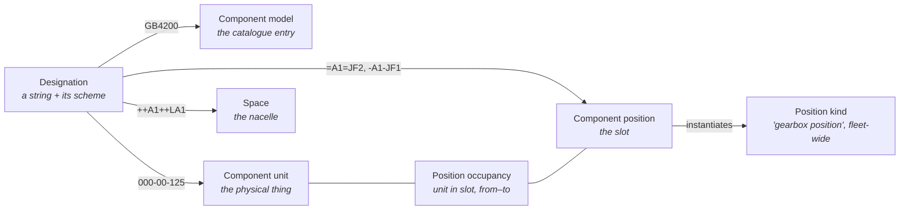

# WESO — Wind Energy System Ontology

**A small, formal core that lets the many ways of naming wind turbine components be connected — without any one of them becoming the master.**

[](https://github.com/OWNER/weso/actions/workflows/ci.yml)


> **Status: draft for discussion.** The core is stable enough to build examples on, but names and structure may still change. See [open questions](docs/open-questions.md).

---

## The problem in one paragraph

A wind turbine gearbox can be called `=A1=JF2` (by its function), `-A1-JF1` (by its product tag), `GB4200` (by its part number), `000-00-125` (by its serial number), `WTG07/WTRM1` (by its SCADA logical node), and "Gearbox" (by a failure-statistics spreadsheet). These strings do **not** name the same thing. Some name a slot in the turbine, some name a catalogue entry, one names a 41-tonne piece of steel, one names a space in the nacelle. Every system mixes these up in its own way, and when you try to combine data from two systems — to pool failure statistics across fleets, say — the mix-ups compound silently.

## What WESO proposes

Give each of those things its own home, and make every source system declare which home its strings point to.



That is most of WESO. Around it sit a few supporting ideas — functions, three kinds of physical item, and the bookkeeping that makes data from different sources comparable. The whole core is about 20 classes. It is aligned with [BFO](https://basic-formal-ontology.org/), validated as OWL 2 DL, and checked with SHACL.

**Read next:** [Why WESO exists](docs/why-weso.md) · [Core concepts in plain language](docs/core-concepts.md) · [Worked examples](docs/worked-examples.md)

## What WESO is not

- **Not a component taxonomy.** WESO does not list every bearing and bolt. Kinds of component belong in domain ontologies (such as the Wind Energy Ontology, WEO) that build on WESO.
- **Not a new designation standard.** It does not replace RDS, ISO 14224 or anyone's tag list. It sits between them.
- **Not an operations ontology.** Signals, measurements and SCADA data belong in the Operations Ontology (OpOn), which points into WESO.

## How it gets used

**In other ontologies** — WESO is the layer that domain and application ontologies stand on. The Wind Energy Ontology adds the kinds of component and function; the Operations Ontology attaches signals to WESO positions; extensions for failure modes or life-cycle assessment hang off WESO's lifecycle events. → [Using WESO in other ontologies](docs/use-in-ontologies.md)

**In software** — WESO turns data integration into something checkable: import a tag list or a maintenance history, declare what each column names, and let the shapes catch the mistakes (an RDS tag mapped onto a serial number, two blades in one slot, a gearbox recorded in a blade position). Statistics computed on WESO positions come out right by construction. → [Using WESO in software and systems integration](docs/use-in-software.md)

**Alongside other semantic artefacts** — standards, thesauri and other ontologies connect through four clearly separated kinds of link. → [Alignment with other standards and artefacts](docs/alignment.md)

## Repository layout

```
ontology/       weso-core.ttl — the kernel; imports/ holds BFO and an IAO extract
shapes/         SHACL shapes: the checks the kernel promises
alignments/     projection contracts for designation schemes (RDS for WTG so far)
examples/       worked examples in Turtle, plus SPARQL queries
tests/          pytest suite and fixtures that must fail validation
scripts/        validator CLI, Python helpers, OWL profile/reasoner check
docs/           plain-language documentation and decision records (adr/)
```

## Quick start

```bash
pip install -r requirements.txt
python -m pytest -v                                    # all checks
python scripts/validate.py examples/blade-replacement.ttl
```

Open `ontology/weso-core.ttl` in [Protégé](https://protege.stanford.edu/); the catalog file next to it resolves the imports offline. To run the OWL 2 DL and reasoner checks locally you need Java and [ROBOT](http://robot.obolibrary.org/):

```bash
ROBOT_JAR=path/to/robot.jar scripts/check-owl.sh
```

## Contributing

Questions, objections and counter-examples are the most useful contributions at this stage. Every design decision has a short record in [`docs/adr/`](docs/adr/) — if you disagree with one, open an issue that references it. See [CONTRIBUTING.md](CONTRIBUTING.md) and [GOVERNANCE.md](GOVERNANCE.md).

## License

- Ontology, shapes, examples and documentation: [CC BY 4.0](LICENSE)
- Scripts and tests: [MIT](LICENSE-CODE)
- Third-party material (BFO, IAO extract): see [NOTICE.md](NOTICE.md)

## Citing

See [CITATION.cff](CITATION.cff).
