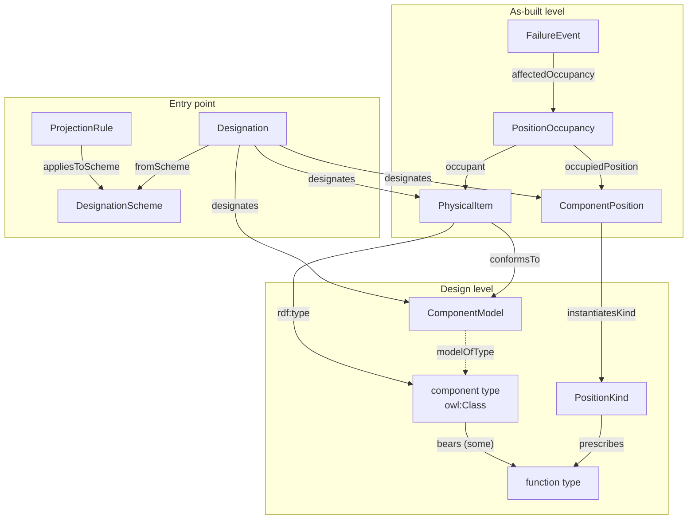

# Core concepts, in plain language

This page explains every idea in the WESO kernel without assuming you know ontology jargon. Formal names are in `code`; the [glossary](glossary.md) has one-line definitions.

## The org chart analogy

Think of a company's org chart.

- There is a box labelled **VP of Engineering**. The box can exist before anyone is hired, stay empty for months, and be held by three different people over ten years. It is still the same box.
- **Maria** is a person. She exists whether or not she is in any box.
- Maria's **ability to lead engineers** is hers. It goes with her if she changes jobs.
- Maria **being VP** is something she is only while she is in the box.
- The words "VP of Engineering" printed on the chart are just a **label** for the box.
- Maria's **tenure**, 2019 to 2024, connects her to the box for a stretch of time.

Every one of these has a direct counterpart in WESO:

| Org chart | WESO | Turbine example |
|---|---|---|
| The box | `ComponentPosition` | Blade position B of turbine T07 |
| "VP" as a kind of box, in every company | `PositionKind` | "Blade position", across the fleet |
| Maria | `ComponentUnit` | Blade serial 4417 |
| Her ability to lead | `ComponentFunction` | The blade's capacity to turn wind into torque |
| Her being VP | `OccupancyRole` | Being the *replacement* blade |
| The printed label | `Designation` | `-A1-RB2` |
| Her tenure | `PositionOccupancy` | Serial 4417 in position B since June 2024 |

Most of the confusion in this field comes from collapsing two or more of these columns into one.

## Positions: the slots things go into

A **component position** is a slot in one particular machine: *blade position B of T07*. It is the thing maintenance systems call a functional location or tag.

The surprising thing about positions is what makes them themselves. An ordinary object is itself because of its material — this blade is this blade because of this fibreglass. A position is the opposite: you can remove everything in it, install something completely different, and it is still the same position. Total replacement is the normal case.

Nor is a position a place. Blade 1 sweeps through exactly the space blade 2 occupied a third of a turn earlier. What tells blade position 1 from blade position 2 is a convention someone wrote down — nothing physical, nothing geometric. So WESO treats a position as **information**: a record in a configuration, like "seat 14A" on a seating plan. ([ADR-0002](adr/0002-positions-are-information.md))

A **position kind** is the generic slot shared across machines: *blade position*, *gearbox position*, *planet bearing position*. Every turbine with three blades has three positions of the kind "blade position". Position kinds are what WESO counts by. ([ADR-0003](adr/0003-position-kind-is-the-counting-key.md))

Positions are arranged in trees. The same position can sit in more than one tree, because designation standards break a turbine down in several ways at once — by function, by product, by host, by location — and those trees don't line up. WESO keeps a separate parent link for each (`functionalParent`, `assemblyParent`, `hostedBy`, `locatedIn`).

## Physical items: what actually exists

A **physical item** is anything material that can fill a position. There are three kinds, distinguished by how you keep track of them:

- **Component unit** — one thing, tracked individually, usually by serial number. A blade, a gearbox, a whole turbine.
- **Population item** — many things tracked as a set. The bolts of a flange; the rollers of a bearing. You know there are 96 bolts; you don't know which is which.
- **Portion of material** — stuff that mixes and splits, tracked by amount. The 380 kg of oil in a gearbox. Top it up and it is still "the gearbox oil".

The distinction matters in practice. If a refurbished bearing had only its rollers renewed, the steel replaced is a fraction of the bearing's mass, not all of it. If three planet bearings share one oil charge, their failures are not independent observations. ([ADR-0004](adr/0004-three-kinds-of-physical-item.md))

## Types and models: two kinds of "what is it?"

"What is this?" has two different answers, and WESO keeps them apart. ([ADR-0005](adr/0005-type-versus-model.md))

- A **component type** is a *kind* of thing, defined by what it does: blade, gearbox, planet bearing. Every blade is a blade, whoever made it. In the Turtle files a type is simply an OWL class; units are members of it.
- A **component model** is a *product specification*: ACME B-73P, revision C, part number ACME-B73P, nominal mass 27.5 t. It is a document, really. It can be revised or discontinued without any installed blade ceasing to exist. A unit *conforms to* a model.

The model carries catalogue figures (nominal mass). The unit carries its own measured figures. This sounds pedantic until you sum mass across a fleet and find the catalogue entries counted alongside the blades.

## Function: the word that means three things

When a source system says "function", it can mean any of three things. WESO separates them. ([ADR-0001](adr/0001-rds-function-is-not-bfo-function.md))

1. **What the item can do because of how it's built.** A blade converts wind into torque. Move it to another turbine and it still can. This is a `ComponentFunction`, borne by the item.
2. **The box in a functional diagram.** `=A1=RB1=RB2` in an RDS function-aspect designation names a box in a breakdown of the turbine by function. It exists before any blade is built and changes when a blade moves between identical slots — so it can't be the blade's own capability. It names a **position**.
3. **What the item is doing in its current slot.** Being "the replacement blade" depends entirely on installation history. This is a **role**.

The link between them: a position kind *prescribes* a function, and an item may occupy the slot only if it *bears* that function. This is the only constraint WESO places on what goes where, and the shapes check it. Constraining by function rather than by product means a valid substitute from another manufacturer is accepted. ([ADR-0007](adr/0007-function-is-the-only-occupancy-constraint.md))

## Occupancy: who was in which slot, when

A **position occupancy** records that one item filled one position from a start date to an end date (or until now). It is the most important bookkeeping object in WESO because it is where exposure time comes from.

Reliability statistics need a denominator: how much operating time did this population accumulate? WESO's answer is **position-time**: sum the occupancies. Replace a blade and the same position's record continues with a new occupant; the population does not grow. ([ADR-0010](adr/0010-occupancy-is-reified.md))

"Original" and "replacement" are never typed in. They fall out of the occupancy record: the first occupancy of a position is original, later ones are replacements.

## Designations and schemes: the entry point

A **designation** is a string from some system, together with the **scheme** it came from. `-A1-RB2` from RDS for WTG. `ACME-B73P-4417` from ACME's serial register.

The string alone never tells you what it names. `000-00-125` could be a serial number or a part number; nothing in the characters settles it. The scheme does. So every designation must say where it came from, and every scheme declares, through **projection rules**, what its designations name:

- RDS for WTG: `=`, `-` and `+` designations name positions; `++` designations name spaces.
- A serial register: designations name component units.
- A parts catalogue: designations name component models.

Once those rules exist, a mistake like mapping an RDS tag onto a serial number is caught automatically. Across all four RDS aspects, nothing ever names a physical unit — only serial numbers do.

## Comparability: making pooled data honest

Two more ideas make it safe to combine data from different sources.

- **Granularity.** Each scheme breaks things down to its own depth. ISO 14224's "maintainable item" and depth 3 of an RDS tree are different measurements. WESO records the level on both the position kind and each designation, and keeps each scheme's scale separate unless someone argues a comparison is valid.
- **Attribution scope.** When a failure is recorded at a position, what does it cover — the bearing alone, the bearing with its seals, the whole assembly? Different reporting schemes draw that line differently. Declaring it on the position kind turns an export into a check instead of an assumption.

Finally, **reporting labels** attach an external scheme's category to a WESO position kind — "our *planet bearing position* is their *Gearbox / Bearings / Planet*". Labels are applied to results after they are computed, never used to compute them. Remove every label and every number stays the same; the test suite checks exactly that.

## How it fits together

