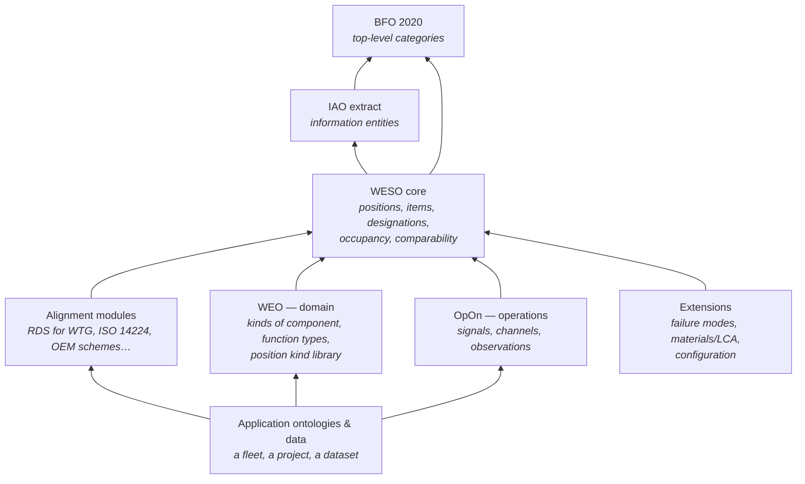
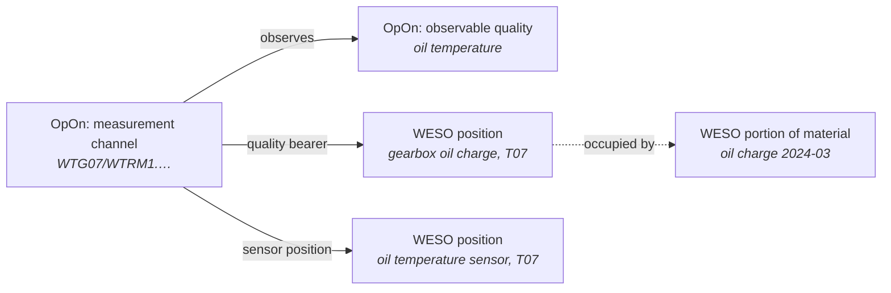

# Using WESO in other ontologies

WESO is deliberately small. It is the layer other ontologies stand on, not the place where domain knowledge accumulates. This page explains how the pieces fit, using the two sibling ontologies WESO was designed alongside — the **Wind Energy Ontology (WEO)** and the **Operations Ontology (OpOn)** — and the extension modules that are expected to follow.

## The stack

Arrows point from the importer to what it imports. **WESO never imports anything above it.** That one rule keeps the core neutral: it does not know which components exist, which signals are measured, or which standards are in use.

## Rules for building on WESO

1. **Specialise, don't redefine.** A domain ontology adds subclasses of WESO classes (`Blade ⊑ ComponentUnit`, `PitchFunction ⊑ ComponentFunction`). It does not define its own notion of position, occupancy or designation.
2. **Kinds of component are OWL classes.** Write `ex:Blade rdfs:subClassOf weso:ComponentUnit`, with the function as a class restriction on `weso:bearsFunction`. Units are `rdf:type ex:Blade`. ([ADR-0006](adr/0006-no-punning-by-default.md))
3. **Function types are OWL classes too.** Each blade bears its *own* aerodynamic torque function; the type is a class under `weso:ComponentFunction`.
4. **Point from individuals to classes with annotation properties.** `weso:prescribesFunction` and `weso:projectsOnto` are annotation properties for this reason. If you need a similar pointer, follow the same pattern. ([ADR-0008](adr/0008-staying-in-owl2-dl.md))
5. **Put "must" in SHACL, not OWL.** OWL will never complain that something is missing. If a rule should *flag* bad data, write a shape.
6. **Run the checks.** `scripts/check-owl.sh` and the SHACL shapes work on any module that imports WESO.

## WEO — the domain layer

The Wind Energy Ontology is where wind-specific knowledge lives. Against WESO, it is expected to provide three libraries:

| WEO provides | As | Example |
|---|---|---|
| Kinds of component | subclasses of `weso:ComponentUnit`, `weso:PopulationItem`, `weso:PortionOfMaterial` | `Blade`, `PlanetBearing`, `TowerFlangeBoltSet`, `GearOil` |
| Kinds of function | subclasses of `weso:ComponentFunction` | `AerodynamicTorqueFunction`, `PlanetSupportFunction` |
| A library of position kinds | individuals of `weso:PositionKind`, each prescribing a function type | `pk-blade`, `pk-main-bearing`, `pk-planet-bearing` |

The **position kind library** matters most. Position kinds are WESO's counting key: two datasets can only be pooled if their positions instantiate the *same* position kinds. A shared, curated library in WEO is what lets data from different operators meet. The examples in this repository define their own position kinds under `example.org` only because WEO's library does not exist yet.

What WEO should *not* do is import a designation standard's tree as its class hierarchy. The RDS breakdown is a tree of positions, not a tree of kinds — "main bearing system" is a slot, not a kind of thing. ([ADR-0001](adr/0001-rds-function-is-not-bfo-function.md))

## OpOn — the operations layer

Signals, SCADA channels and measurements are out of WESO's scope and belong in OpOn. The boundary is clean because OpOn needs only one thing from WESO: positions to point at. ([ADR-0009](adr/0009-signals-belong-to-opon.md))

A SCADA tag such as `WTG07/WTRM1.<DataObject>` does not name a component. It names a **measurement channel**, which ties together three separate things:

Two consequences for WESO:

- **Sensors stay in WESO's position tree**, even though signals don't. OpOn has to distinguish the sensor's slot from the thing being measured — otherwise a failed thermocouple is recorded as a gearbox fault.
- **Projection rules may need compound keys.** In IEC 61400-25 one logical node can span positions that designation standards split apart, so the logical node alone can't resolve the position; the logical node together with the data object can. `weso:sourceConstruct` is repeatable for exactly this reason.

## Extensions

These are expected as separate modules, each importing WESO:

| Extension | Hooks it uses in WESO |
|---|---|
| **Configuration / design baseline** — what a turbine model specifies for each slot, approved alternates, multiplicity, effectivity | `PositionKind`, `ComponentModel`; deliberately kept out of the core ([ADR-0007](adr/0007-function-is-the-only-occupancy-constraint.md)) |
| **Failure modes and causes** | `FailureEvent`, `affectedOccupancy`, `AttributionScope` |
| **Materials and life-cycle assessment** | `hasMaterial`, `hasMassKg`, `nominalMassKg`, `RefurbishmentEvent`, `replacedItem` |
| **Maintenance** | `InstallationEvent`, `RemovalEvent`, `RefurbishmentEvent` |

## Alignment modules

Each designation scheme gets a small module that declares its projection contract — see [`alignments/`](../alignments) and [alignment.md](alignment.md). These are thin: a scheme individual, a handful of projection rules, and the scheme's granularity scale.
