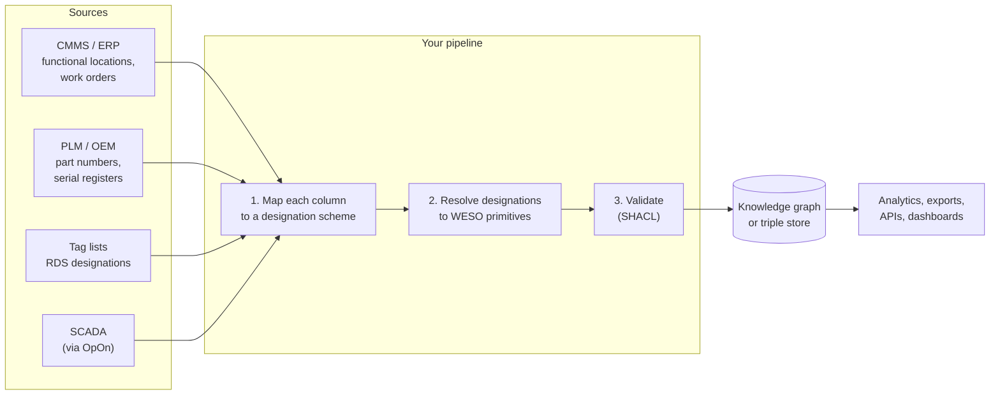

# Using WESO in software and systems integration

This page is for developers and data engineers. You do not need to know BFO to use WESO; you need to know which of a handful of things each of your identifiers names, and the tooling checks the rest.

## What WESO gives a software project

| Problem | What WESO provides |
|---|---|
| The same string means different things in different systems | Every identifier is stored with its scheme, and each scheme declares what its identifiers name |
| Import scripts silently map tags onto serial numbers | A SHACL check rejects any designation that names the wrong kind of thing |
| Replacement histories corrupt reliability statistics | Exposure is computed per position from occupancy records, so replacements extend a record rather than growing the population |
| Two data sources can't be pooled because their categories differ | Statistics are grouped by WESO position kinds; each source's categories become labels on the output |
| Swapping a part from another manufacturer looks like an error | Slots constrain *function*, not product, so valid substitutes pass |
| Integration logic lives in code nobody else can read | Projection contracts are data — reviewable, versionable, testable |

## The integration pattern



### Step 1 — declare your schemes

Every source of identifiers becomes a `DesignationScheme` with at least one `ProjectionRule`. Standard schemes ship in [`alignments/`](../alignments); your own (an operator's tag convention, a manufacturer's serial register) are a few lines each:

```turtle
ex:acme-serials a weso:DesignationScheme ;
  rdfs:label "ACME serial register" .

ex:acme-serials-rule a weso:ProjectionRule ;
  weso:appliesToScheme ex:acme-serials ;
  weso:sourceConstruct "serial number" ;
  weso:projectsOnto    weso:ComponentUnit .     # serials name physical units
```

The rule is the contract. Writing it forces the question every integration project skips: *what does this column actually name?*

### Step 2 — map each row

A typical maintenance export row:

| turbine | tag | serial | part no | installed | removed |
|---|---|---|---|---|---|
| T07 | -A1-RB2 | ACME-B73P-4417 | ACME-B73P | 2024-06-18 | |

becomes four things, not one:

- a **designation** `-A1-RB2` (RDS scheme) → designates the **position**
- a **designation** `ACME-B73P-4417` (serial scheme) → designates the **unit**
- a **designation** `ACME-B73P` (parts scheme) → designates the **model**
- an **occupancy** linking that unit to that position from 2024-06-18

The most common integration bug — treating the row as "one component" — becomes impossible to express without the validator noticing.

### Step 3 — validate

```bash
python scripts/validate.py my-fleet.ttl
```

or from Python:

```python
from wesotools import load, validate
ok, results = validate(load("my-fleet.ttl"))
```

The shapes in [`shapes/weso-core-shapes.ttl`](../shapes/weso-core-shapes.ttl) check, among other things:

- every designation has a scheme and names exactly one thing;
- what it names is of a kind its scheme's projection rules allow;
- no two component units occupy one position at the same time;
- every occupant bears the function its position prescribes;
- occupancies start before they end.

Put this in your data pipeline's CI the way you would a schema check. Any SHACL engine works (pySHACL, TopBraid, Apache Jena, RDF4J, GraphDB); the SPARQL-based constraints need an engine with SHACL-SPARQL support.

**Note:** the SPARQL constraints follow `rdfs:subClassOf` paths, so load the WESO ontology (and your domain ontology) into the same graph as the data being validated.

## Querying

Queries live in [`examples/queries/`](../examples/queries):

| Query | Answers |
|---|---|
| `exposure.rq` | Position-time and failures per position kind |
| `original-vs-replacement.rq` | Which occupancies are originals and which are replacements |
| `resolve-designation.rq` | What a string names, and what kind of thing that is |
| `export-with-reporting-labels.rq` | Results labelled with an external vocabulary's categories, if one is loaded |

Two habits keep queries correct:

1. **Group by `weso:PositionKind`.** It is the only key guaranteed to mean the same population across sources.
2. **Join external labels last, with `OPTIONAL`.** Labels describe results; they must never decide which rows are counted.

## APIs and JSON-LD

For web services, [`ontology/weso-context.jsonld`](../ontology/weso-context.jsonld) maps plain JSON keys onto WESO terms, so an API can exchange ordinary-looking JSON that is also valid RDF. [`examples/json-ld/blade-swap-event.jsonld`](../examples/json-ld/blade-swap-event.jsonld) is a blade-swap payload — close one occupancy, open another, register the new serial:

```json
{ "id": "ex:occ-T07-C-2", "type": "PositionOccupancy",
  "occupiedPosition": "ex:pos-T07-blade-C", "occupant": "ex:blade-sn-5120",
  "occupancyStart": "2026-10-09T00:00:00" }
```

The test suite merges this payload into the Turtle example, validates the result, and checks the statistics move as they should. An event-driven system can do the same on every incoming message.

## Generating designations

Parsing designations is fully supported. *Generating* them is only partly so: the structure of an RDS tag can be derived from the position tree, but the counting numbers (`RB1` vs `RB2`, `WTRM1` vs `WTRM2`) carry no meaning by the standards' own definition, so they cannot be computed. A system that emits designations must store them. Whether WESO should standardise how is an [open question](open-questions.md).

## Pooling data across organisations

Two operators can pool data without sharing identifiers, schemes or tools, provided:

1. both map their positions to the **same position kinds** (ideally from a shared library such as WEO's);
2. both declare **attribution scope** on those kinds, so a mismatch in where failure boundaries are drawn shows up instead of hiding;
3. exposure is summed over **occupancies**, not units or turbines.

Each party keeps its own tags, serials and categories. The pivot is the position kind.

## Practical notes

- **Dates** are `xsd:dateTime`. (`xsd:date` is not part of OWL 2 DL; see [ADR-0008](adr/0008-staying-in-owl2-dl.md).)
- **IRIs.** WESO terms live under `https://w3id.org/ontoforge/weso/`. Mint your own instance IRIs in your own namespace; never put instance data in WESO's.
- **Versioning.** Releases get a version IRI (`…/weso/0.1.0/`). Pin it in production; follow the unversioned IRI in development. See [CHANGELOG](../CHANGELOG.md).
- **Scale.** The validation and queries here are written for clarity. At fleet scale, load data into a triple store with RDFS inference enabled and the subclass paths become cheap.
- **Offline use.** `wesotools.load()` resolves `owl:imports` from local files via the catalogs; nothing is fetched from the web.
